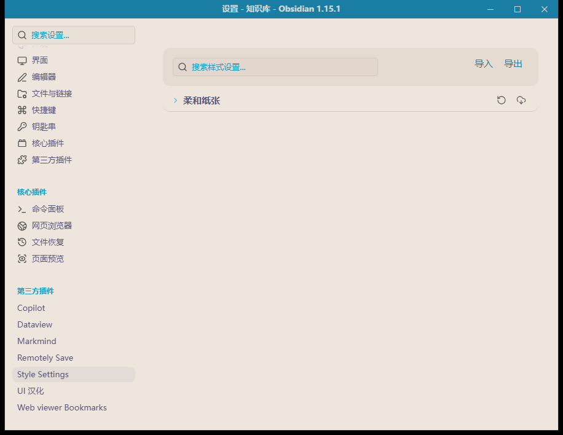

# UI 汉化 · Obsidian 插件界面中文化

> 把英文 Obsidian 插件的界面文案翻成中文 —— **只改显示层文本，不改任何插件源码，随时一键还原。**

Obsidian 本体有中文，但绝大多数第三方插件没有。这个插件在**显示层**做翻译：拦截界面上的英文文本节点，换成中文；插件文件一个字节都不动，卸载后零残留。



## 特性

| 能力 | 说明 |
|---|---|
| **零侵入** | 只写 `textContent` 与 `placeholder / aria-label`，永不 `innerHTML`、永不修改其他插件文件与数据 |
| **可逆** | 每个节点都保存原文快照，「还原界面原文」立即回到英文；卸载无残留 |
| **不碰笔记** | 编辑器、阅读视图、代码块、公式、画布、PDF 全部跳过 |
| **术语保护** | 品牌与技术名词（Obsidian / Markdown / Dataview / API / JSON…）永远保持英文，可自定义追加 |
| **离线可用** | 内置 3000+ 条词条，纯词典模式零网络请求 |
| **可选 AI 补翻** | 词典没覆盖的新文案，用你自己的 API Key 批量翻译，带质量闸门与缓存 |
| **多窗口** | 主窗口、独立设置窗口、弹出工作区窗口都跟着翻 |
| **主题支持** | 连 Style Settings 从主题 CSS 里读出来的标题/说明也能翻 |

## 安装

### 方式一：手动（最稳）

1. 从 [Releases](../../releases) 下载最新版本的 `main.js`、`manifest.json`、`styles.css`
2. 放进 `<你的库>/.obsidian/plugins/obsidian-ui-zh/`
3. Obsidian → 设置 → 第三方插件 → 关闭安全模式 → 启用「UI 汉化」

### 方式二：BRAT（可自动更新）

1. 安装 [BRAT](https://github.com/TfTHacker/obsidian42-brat)
2. BRAT → Add Beta plugin → 填 `你的GitHub用户名/obsidian插件汉化`
3. 启用「UI 汉化」

## 使用

装上就生效：面板、菜单、状态栏、通知里命中词典的文案会直接变中文。

要翻某个插件的**设置页**（那里通常全是英文）：

```
1. 打开那个插件的设置页
2. Ctrl+P → 「扫描当前界面并翻译」
   或按你绑的快捷键（设置 → 快捷键 → 搜 "UI 汉化"）
3. 1~3 秒，当前这一屏就变中文，词条存进词典，下次打开直接中文
```

### 可选：接自己的 AI 补翻

设置 → UI 汉化 → LLM 翻译通道，填：

| 项 | 值 |
|---|---|
| 接口地址 | `https://api.deepseek.com`（任何 OpenAI 兼容网关都行） |
| API Key | 你的 key |
| 模型 | `deepseek-chat` |

点「测试」看到 `连接正常` 即可。**不填也能用**，只是新文案只会进「待译」队列不会翻。

费用量级：单插件 200~450 条约几分钱，之后靠缓存，增量几乎为 0。

### 词典自己长

```
dict/
  base.json                通用界面词
  glossary.json            keep（永不翻）+ fixed（固定译法）
  plugins/<插件id>.json    每个插件一片
  plugins/_theme.json      主题 Style Settings 的标题与说明
  plugins/_auto.json       「扫描当前界面」收集的零散词条
```

手改任何 JSON 后，命令面板执行 **「重新加载词典并重刷界面」** 即可生效，不用重启 Obsidian。

想让某个词保持英文：设置里「术语保护」加一行，重载 —— 即使词典里有译文也会被屏蔽。

## 边界（务必知道）

- **画布内文字翻不了**：Excalidraw / Canvas / Mindmap 的节点文字是图形层，不是 DOM 文本
- **虚拟滚动列表**只翻可见部分，滚到哪翻到哪
- **极少数插件**用自己文案做逻辑判断（拿 textContent 比对），可能受影响 —— 用设置里的「额外排除区域」填 CSS 选择器规避
- 与 `i18n+ (lang-plus)` 功能重叠，建议只留一个

## 隐私

**默认完全离线，没有任何遥测。** 只有你填了 Key 并主动点翻译按钮时，才会把**界面文案字符串**发给你的接口；笔记内容、路径、Key 本身绝不外发。

详见 [PRIVACY.md](PRIVACY.md)。

## 兼容性

- Obsidian `>= 1.4.0`，桌面端与移动端均可
- 无构建步骤、无运行时依赖，`main.js` 单文件

## 开发

```bash
node --check main.js     # 语法检查
```

主要模块都在 `main.js` 顶部：

| 区域 | 职责 |
|---|---|
| 纯函数区 | 归一化、候选判定、术语掩码、质量闸门 |
| DOM 守卫 | 跳过编辑器/代码/画布/表单 |
| 词典加载 | 分片合并 + 术语屏蔽 |
| 观察器 | MutationObserver，事件驱动零轮询，空闲批处理 |
| LLM 通道 | 批量请求、JSON 宽松解析、失败重试、缓存 |

## 许可

[MIT](LICENSE)。词典为各插件公开界面文案的中文译文，随仓库同许可发布。

---

**非官方声明**：本项目为第三方社区作品，与 Obsidian（Dynalist Inc.）无隶属关系。Obsidian 是 Dynalist Inc. 的商标。

*English: A display-layer translator for Obsidian plugin UIs. It never modifies plugin files, keeps technical terms in English, works offline with a bundled dictionary, and offers optional AI translation with your own API key. See [PRIVACY.md](PRIVACY.md).*
